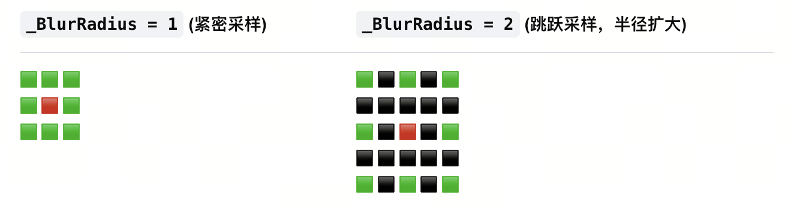

> 边缘高斯模糊，这里只示例十字模糊简易方法，只对中心和上下左右五个点进行加权平均，其他方法同理可得。
> 在 Shader 中，卷积核权重必须满足一个核心原则：所有权重系数相加必须等于 1。如果大于 1 画面会变亮（过曝），小于 1 画面会变暗。

### 示例

1，假设图像部分如下:

$$
    \begin{pmatrix}
    0 & 0 & 0 & 1 & 0 & 0 & 0 \\
    0 & 0 & 0 & 1 & 0 & 0 & 0 \\
    0 & 0 & 0 & 1 & 0 & 0 & 0 \\
    0 & 0 & 0 & 1 & 0 & 0 & 0 \\
    0 & 0 & 0 & 1 & 0 & 0 & 0 \\
    \end{pmatrix}
$$

2, 卷积核设置为3x3大小，中间权重最大为0.5，四角较小，权重如下:

$$
    \begin{pmatrix}
    0 & 0.125 & 0 \\
    0.125 & 0.5 & 0.125 \\
    0 & 0.125 & 0
    \end{pmatrix}
$$

3, 对于第一步的图像进行卷积:

 - 1，对于(1,1)、(2,1)、(1,2)、(2,2)、(1,3)、(2,3)等像素，卷积后均是0

 - 2，对于(3,1)像素，卷积 = 0 + 0 + 0 + 0 + 0 + 0.125 + 0 + 0 + 0 = 0.125
 
 - 3，对于(4,1)像素，卷积 = 0 + 0 + 0 + 0 + 0.5 + 0 + 0 + 0.125 + 0 = 0.625
 
 - 4，对于(3,2)像素，卷积 = 0 + 0 + 0 + 0 + 0 + 0.125 + 0 + 0 + 0 = 0.125

 - 5，对于(4,2)像素，卷积 = 0 + 0.125 + 0 + 0 + 0.5 + 0 + 0 + 0.125 + 0 = 0.75

 - 6，对于(3,3)像素，卷积 = (3,2) = 0.125

 - 7，对于(3,4)像素，卷积 = (3,3) = 0.125

 ...

 4, 经过第三步的卷积操作后，新的图像变为:

$$
    \begin{pmatrix}
    0 & 0 & 0.125/9 & 0.625/9 & 0.125/9 & 0 & 0 \\
    0 & 0 & 0.125/9 & 0.75/9 & 0.125/9 & 0 & 0 \\
    0 & 0 & 0.125/9 & 0.75/9 & 0.125/9 & 0 & 0 \\
    0 & 0 & 0.125/9 & 0.75/9 & 0.125/9 & 0 & 0 \\
    0 & 0 & 0.125/9 & 0.625/9 & 0.125/9& 0 & 0 \\
    \end{pmatrix}
$$

5, 原始图像在边缘处即被模糊化，其他模糊算法类似。

### 修改模糊半径的方式

1，修改卷积核大小
 - 即上面直接用卷积核进行模糊的方式，对每个像素的计算量是`n*n`次采样, 卷积核大时可能会导致性能暴跌。

2，修改采样步长（Shader 里的主流做法 🌟）
 - 属于数学上的扩大采样半径，卷积核依然保持3x3，9次采样，但是扩大每次采样点间的间距 UV Offset

 ```C++
float2 uvOffset = i.uv + float2(x, y) * _MainTex_TexelSize.xy * _BlurRadius;
 ```



 - 优势:
    - 调整模糊半径，不影响采样次数
    - 动态可调
- 缺点:
    - 如果间距过大，中间漏掉像素过多，可能会出现鬼影/重影