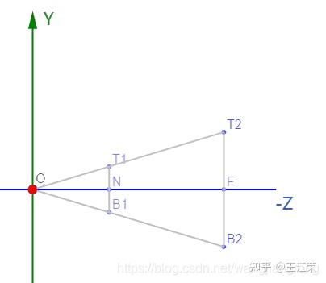

### 透视矩阵推导

1，近平面、远平面位于Z轴负方向，坐标分别为 -n、-f，对任意点P(x, y, z)在进平面上的X轴坐标进行推导：

P'(x', y', z')坐标及相似三角形公式:

$$
\frac{x'}{x} = \frac{-n}{z}
$$

=> 
$$
x'=\frac{x·n}{-z}
$$
 
 同理
 $$
y'=\frac{y·n}{-z}
$$

2, 构建矩阵

x‘、y’的分母都是-z，所以可通过齐次坐标w来求解：

$$
    \begin{pmatrix}
    n & 0 & 0 & 0 \\
    0 & n & 0 & 0 \\
    0 & 0 & A & B \\
    0 & 0 & -1 & 0
    \end{pmatrix}
$$

其中A、B当前都是未知量.
由矩阵与列向量相乘：
$$
{(x, y, z, 1)}^T
$$
可得到:
$$
{(nx, ny, Az+B, -z)}^T
$$
对 Az+B分量，当z在近平面-n时，投影坐标还是-n，当在远平面-f时还是-f(ndc坐标系范围从-1到1)，所以:

$$
\frac{A(-n)+B}{n} = -1
$$

$$
\frac{A(-f)+B}{f} = 1
$$

联立两个公式可求解出A和B:

$$
A=\frac{n+f}{n-f}
$$

$$
B=\frac{2f·n}{n-f}
$$

3，ndc坐标系下，范围为-1到1，首先对于x:

$$
X_{ndc} \in {-1, 1}
$$
x轴范围为left，right, 故
$$
\frac{x'-l}{r-l}=\frac{x_{ndc}+1}{2}
$$
可得:
$$
x_{ndc}=\frac{2x'}{r-l} - \frac{r+l}{r-l}
$$
由第一步得到的x'可得：
$$
x_{ndc}=\frac{2xn}{-z·(r-l)} + \frac{z(r+l)}{-z(r-l)}
$$
同理可得
$$
y_{ndc}=\frac{2ny}{-z(t-b)}+\frac{z(t+b)}{-z(t-b)}
$$
所以，透视矩阵前两行为:
$$
    \begin{pmatrix}
    \frac{2n}{r-l} & 0 & \frac{r+l}{r-l} & 0 \\
    0 & \frac{2n}{t-b} & \frac{t+b}{t-b} & 0
    \end{pmatrix}
$$
4, 综上，透视矩阵为

$$
    \begin{pmatrix}
    \frac{2n}{r-l} & 0 & \frac{r+l}{r-l} & 0 \\
    0 & \frac{2n}{t-b} & \frac{t+b}{t-b} & 0 \\
    0 & 0 & \frac{n+f}{n-f} & \frac{2nf}{n-f} \\
    0 & 0 & -1 & 0
    \end{pmatrix}
$$